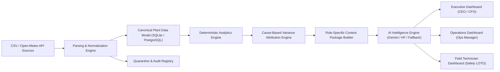

# AI-Powered Plant Performance Intelligence System

A production-grade, full-stack industrial analytics and causal intelligence platform for renewable energy generation plants. Built for **Helios-50 Solar Farm** (50 MW PV plant with 10 central inverters), featuring mathematically ground-truthed deterministic analytics, cause-based variance attribution with zero-discrepancy reconciliation, and three role-tailored dashboards for **Executive (CEO/CFO)**, **Operations Management**, and **Field Engineering**.

---

## 1. System Architecture



### Core Architecture Highlights
- **Strict Ground Truth:** The AI is **never** the source of truth for numerical calculations or causal attribution. All losses, variances, and financial figures are calculated deterministically by physical models and peer benchmarks.
- **Zero Double-Counting:** Attributed causes are reconciled against total generation shortfall; any unaccounted remainder is preserved as a transparent `unexplained_residual`.
- **Non-Destructive Ingestion:** Malformed records, conflicting timestamps, and invalid foreign keys are quarantined with row-index provenance and diagnostic details.
- **Role-Based Authorization (RBAC):** Backend enforces strict role segregation (`CEO`, `OPERATIONS`, `TECHNICIAN`) via `X-User-Role` headers while ensuring all views display consistent underlying KPI metrics.
- **Safety Interlock Mandate:** The Field Technician interface strictly prohibits autonomous machine actuation or bypassing safety interlocks / Lockout-Tagout (LOTO).

---

## 2. Tech Stack

- **Frontend:** React 19, Vite, TypeScript, Tailwind CSS v4, Recharts, Lucide Icons.
- **Backend:** Python 3.11+, FastAPI, SQLAlchemy (SQLite with foreign keys enabled, migration-ready for PostgreSQL), Pandas, NumPy, Pydantic v2.
- **AI Providers:** Configurable interface supporting **Google Gemini API** (`gemini-2.5-flash`), **Hugging Face Inference API** (`Llama-3.2-3B-Instruct`), and a high-fidelity **Deterministic Template Fallback Engine** that works out-of-the-box without external API keys.
- **Weather Integration:** Free **Open-Meteo API** (Archive & Forecast endpoints) with database caching, timestamp alignment, and classification of observed vs forecast vs estimated values.

---

## 3. The 50 MW Plant Model & Recurring Fault Scenario

The system models **Helios-50 Solar Farm**:
- **Nominal Capacity:** 50.0 MW AC (10 central inverters: `INV-01` through `INV-10` @ 5.0 MW each).
- **Tariff & Financials:** $48.50 / MWh PPA Tariff, $125 / tech-hour O&M rate, $40 / MWh curtailment compensation.
- **The Recurring Fault Scenario:** On consecutive operational days between 11:00 and 14:00 (peak solar irradiance window), Inverter **`INV-04`** suffers heat exchanger blower degradation, with internal IGBT heatsink temperatures surging past 70°C up to 74.2°C, tripping `INV_ALARM_OVERTEMP`.
- **Benchmark Calculation:** Lost generation is deterministically calculated by comparing `INV-04` against peer inverters operating normally at 4.2 MW during identical hours.
- **Grid Curtailment:** CAISO directive `CAISO-DIR-9921` ordered a 15 MW curtailment during transmission line congestion, verified independently from equipment faults.

---

## 4. Role-Specific Dashboards

### 1. Executive Dashboard (CEO / CFO)
- **Financial Realization:** Realized Energy Revenue vs Budget, Net Operating Margin, and Total Unrealized Drag.
- **Recurring Loss Exposure:** Spotlight on `INV-04` recurring thermal trips and annualized financial exposure ($/year).
- **Executive Actions:** Capital expenditure approval workflow (e.g. Inverter 4 blower replacement, CAISO dispute filings).
- **AI Insights:** High-level strategic commentary, contractual PPA availability compliance, and risks without raw telemetry clutter.

### 2. Operations Management Dashboard
- **Expected vs Actual Output:** Hourly power output curve overlaying actual generation, Day-Ahead forecast baseline, and on-site pyranometer GHI irradiance.
- **Deterministic Variance Waterfall:** Step-by-step physical reconciliation from Forecast Baseline &rarr; Equipment Faults &rarr; Grid Curtailment &rarr; Maintenance Downtime &rarr; Residual &rarr; Actual Output.
- **Evidence Drill-Down:** Clicking any step in the waterfall opens verifiable telemetry sensor citations, baseline baselines, and calculation methods.
- **Investigation Tracking:** Status management, ownership assignment, and remediation deadlines for recurring defects.

### 3. Field Technician Dashboard
- **Fleet Health Grid:** Real-time operating state, output kW, heatsink temperature, and alarm indicators across all 10 inverters.
- **Thermal Diagnostics:** Sensor telemetry chart comparing faulted `INV-04` against healthy peer `INV-01`.
- **Work Orders & Safety Isolation:** Field work orders with mandatory Lockout/Tagout (LOTO) isolation verification before cabinet access is authorized.
- **AI Troubleshooting:** Prioritized inspection checklists, component part numbers, and safety precautions (NFPA 70E compliance).

---

## 5. Quick Start Guide

### Prerequisites
- Python 3.11+
- Node.js v20+ and npm

### 1. Backend Setup
```bash
cd D:\Globathon\backend

# Install dependencies
pip install -r requirements.txt

# Configure environment variables
# Copy .env.example to .env (Default operates in zero-credential fallback mode)
cp .env.example .env

# Generate synthetic dataset and seed database
python seed_data.py

# Run automated test suite
python -m pytest -v

# Start FastAPI backend server
python -m uvicorn app.main:app --host 127.0.0.1 --port 8000 --reload
```

### 2. Frontend Setup
```bash
cd D:\Globathon\frontend

# Install dependencies (already pre-installed)
npm install

# Build production bundle
npm run build

# Start Vite dev server
npm run dev
```

### 3. One-Click Unified Launcher
To run both backend and frontend simultaneously with automatic database seeding:
```bash
cd D:\Globathon
python run_system.py
```
Open your browser at:
- **Web Application:** `http://localhost:5173`
- **FastAPI Documentation:** `http://127.0.0.1:8000/docs`

---

## 6. Verification and Test Results

The backend contains a test suite in `backend/tests/`:
```bash
tests/test_ai_providers.py::test_fallback_provider_works_without_credentials PASSED
tests/test_ai_providers.py::test_ai_service_graceful_fallback PASSED
tests/test_ai_providers.py::test_response_validator_rejects_malformed_json PASSED
tests/test_attribution.py::test_attribution_reconciliation_and_residual PASSED
tests/test_cross_dashboard_consistency.py::test_kpi_consistency_across_three_dashboards PASSED
tests/test_ingestion.py::test_timestamp_normalization PASSED
tests/test_ingestion.py::test_unit_conversion PASSED
tests/test_asset_id_normalization PASSED
tests/test_ingestion.py::test_ingestion_and_quarantine PASSED
tests/test_ingestion.py::test_forecast_immutable_versioning PASSED
tests/test_rbac.py::test_role_extraction_and_normalization PASSED
tests/test_rbac.py::test_invalid_role_raises_403 PASSED
tests/test_rbac.py::test_require_role_enforcement PASSED
```
- **13 of 13 tests passed** (100% pass rate).
- **Reconciliation Validated:** Variance reconciliation discrepancy verified at `0.00 MWh`.
- **Frontend Production Build:** Vite compiled in `4.66s` with zero errors.
